 
<div align="center">

# 🎫 HelpDesk

### Sistema de gestión de tickets y soporte técnico

Una plataforma web para registrar incidencias, administrar solicitudes, conversar con los usuarios y centralizar el soporte técnico desde un solo lugar.

<br>


<br>


<br><br>

**Desarrollado por [Leonardo Gracia](https://github.com/overrun1026)**

[Ver portafolio](https://www.leonardogracia.com) · [GitHub](https://github.com/overrun1026) · [LinkedIn](https://www.linkedin.com/in/leonardo-gracia-71222124b/)

</div>

---

## 📑 Tabla de contenidos

- [1. Acerca del proyecto](#-1-acerca-del-proyecto)
- [2. Características principales](#-2-características-principales)
- [3. Galería de la aplicación](#-3-galería-de-la-aplicación)
- [4. Tecnologías utilizadas](#-4-tecnologías-utilizadas)
- [5. Arquitectura del proyecto](#-5-arquitectura-del-proyecto)
- [6. Requisitos previos](#-6-requisitos-previos)
- [7. Instalación y ejecución con Docker Compose](#-7-instalación-y-ejecución-con-docker-compose)
- [8. Variables de entorno y claves](#-8-variables-de-entorno-y-claves)
- [9. Crear la cuenta de administrador](#-9-crear-la-cuenta-de-administrador)
- [10. Cómo funciona la aplicación](#-10-cómo-funciona-la-aplicación)
- [11. API y documentación](#-11-api-y-documentación)
- [12. Comandos útiles](#-12-comandos-útiles)
- [13. Seguridad y buenas prácticas](#-13-seguridad-y-buenas-prácticas)
- [14. Autor](#-14-autor)
- [15. Licencia](#-15-licencia)

---

## 🧩 1. Acerca del proyecto

**HelpDesk** es una aplicación web de soporte técnico que permite gestionar solicitudes mediante un sistema de tickets.

Los usuarios pueden registrarse, iniciar sesión, crear incidencias, seleccionar una categoría y prioridad, consultar el estado de sus solicitudes y comunicarse con el administrador mediante comentarios.

El administrador dispone de herramientas para supervisar los tickets, consultar las cuentas registradas, administrar categorías y modificar el estado y la prioridad de las solicitudes.

La aplicación está construida con una arquitectura cliente-servidor. El frontend consume una API REST desarrollada con Node.js y Express, mientras que PostgreSQL almacena la información de forma persistente.

Docker Compose permite ejecutar la base de datos, el backend y el frontend como servicios coordinados.

### 🎯 Objetivos

<table>
<tr>
<td width="50%" valign="top">

**Organización**

Centralizar las incidencias y facilitar su seguimiento desde su creación hasta su resolución.

</td>
<td width="50%" valign="top">

**Control de acceso**

Separar las funcionalidades disponibles para usuarios y administradores.

</td>
</tr>
<tr>
<td width="50%" valign="top">

**Comunicación**

Facilitar la interacción entre el usuario y el equipo encargado de resolver el problema.

</td>
<td width="50%" valign="top">

**Despliegue reproducible**

Configurar los servicios y sus dependencias mediante contenedores.

</td>
</tr>
</table>

---

## ✨ 2. Características principales

### 👤 Autenticación y usuarios

- Registro de nuevas cuentas.
- Inicio y cierre de sesión.
- Autenticación mediante JSON Web Tokens (JWT).
- Contraseñas almacenadas mediante hash con bcrypt.
- Roles de usuario y administrador.
- Rutas protegidas mediante middleware de autenticación y autorización.
- Validación de solicitudes recibidas por la API.

### 🎫 Gestión de tickets

- Creación de tickets con título y descripción.
- Selección de categoría y prioridad.
- Consulta del listado de solicitudes.
- Búsqueda y filtrado de tickets.
- Consulta del detalle de cada ticket.
- Actualización de la información de las solicitudes.
- Gestión del estado y prioridad por parte del administrador.
- Historial de cambios de estado.

### 💬 Comentarios y seguimiento

- Conversación relacionada con cada ticket.
- Comunicación entre usuarios y administradores.
- Consulta de los comentarios de una solicitud.
- Seguimiento de los problemas reportados.

### 🗂️ Administración de categorías

- Consulta de categorías activas.
- Creación de nuevas categorías.
- Edición de categorías existentes.
- Activación y desactivación de categorías.
- Control de las categorías disponibles al crear tickets.

### 🔔 Notificaciones

- Generación de notificaciones asociadas a determinadas acciones.
- Avisos por cambios relevantes en los tickets y asignaciones.
- Consulta de las notificaciones del usuario.
- Marcado de notificaciones como leídas.
- Indicador visual de notificaciones pendientes.

> El indicador se actualiza al consultar o volver a renderizar las secciones correspondientes; no representa un sistema de notificaciones en tiempo real mediante WebSockets.

### 📊 Dashboard

- Resumen de la actividad de soporte.
- Contadores de tickets.
- Visualización de solicitudes según su estado.
- Acceso a las secciones principales de la plataforma.
- Panel diferenciado para usuarios y administradores.

### 🧾 Auditoría y validación

- Módulo de auditoría para registrar operaciones contempladas por la aplicación.
- Middleware centralizado para gestionar errores.
- Validación de datos de entrada.
- Manejo de rutas inexistentes.
- Utilidades para simplificar operaciones asíncronas y paginación.

---

## 🖼️ 3. Galería de la aplicación

Las capturas se almacenan en la carpeta `assets/` ubicada en la raíz del repositorio.

Antes de publicar el proyecto, comprueba que los 15 archivos tengan exactamente estos nombres y que estén en formato PNG.

### 🔐 3.1. Autenticación y registro

<table>
<tr>
<td width="50%" valign="top">

**Inicio de sesión**

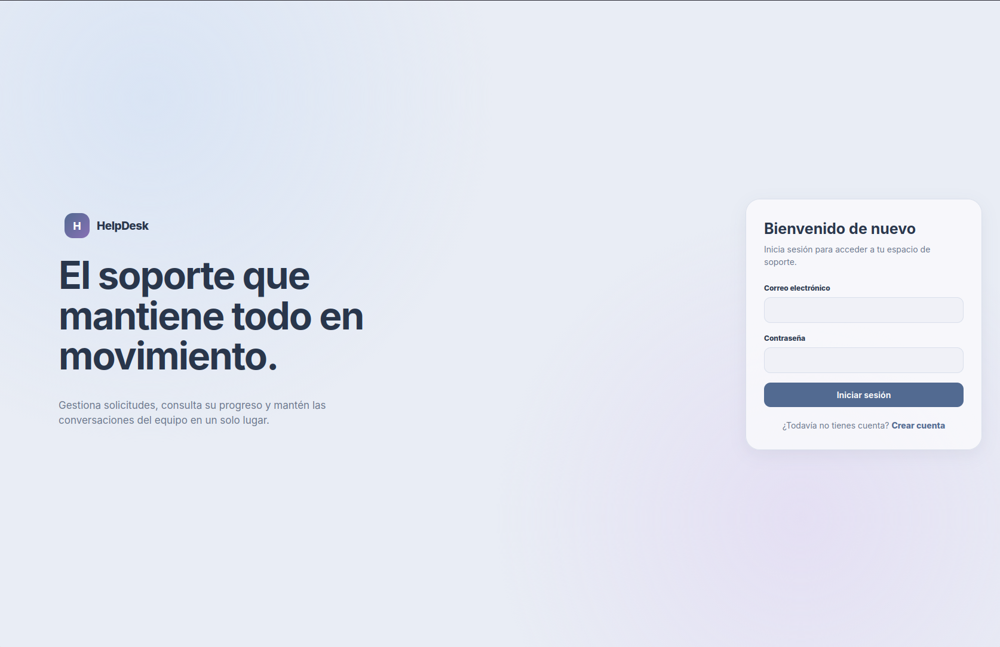

Pantalla de acceso para usuarios registrados.

</td>
<td width="50%" valign="top">

**Crear cuenta**

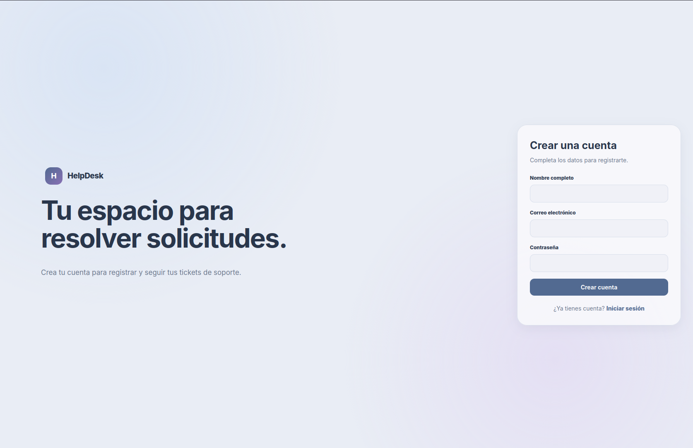

Formulario de registro de nuevos usuarios.

</td>
</tr>
<tr>
<td width="50%" valign="top">

**Registro con datos**

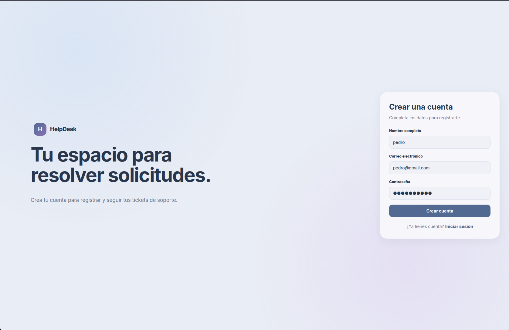

Ejemplo del formulario con los datos de una nueva cuenta.

</td>
<td width="50%" valign="top">

**Captura adicional**


Vista complementaria de la interfaz.

</td>
</tr>
</table>

### 🎫 3.2. Dashboard y gestión de tickets

<table>
<tr>
<td width="50%" valign="top">

**Dashboard del usuario**

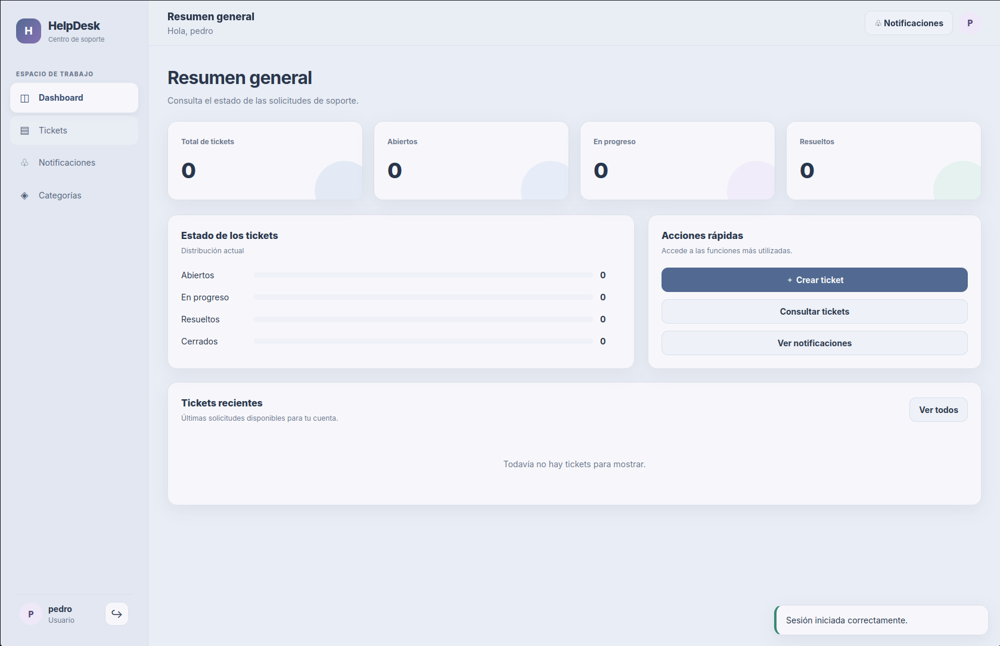

Vista general de la actividad y las solicitudes.

</td>
<td width="50%" valign="top">

**Crear ticket**

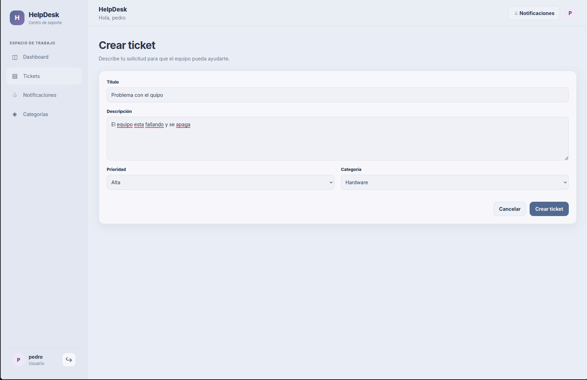

Formulario con título, descripción, prioridad y categoría.

</td>
</tr>
<tr>
<td width="50%" valign="top">

**Dashboard actualizado**

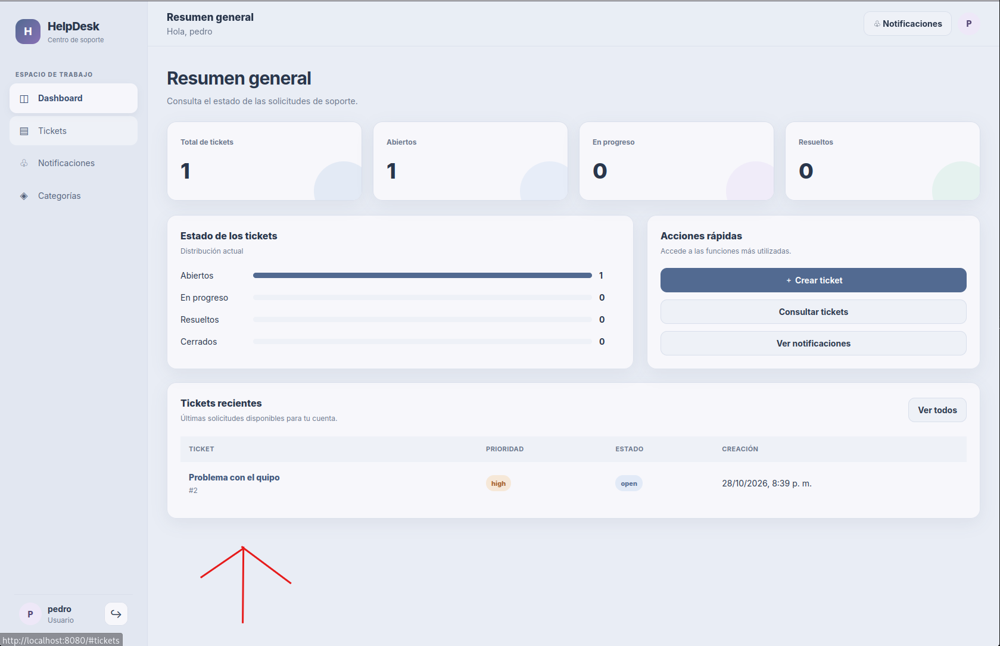

Resumen con el ticket creado y los contadores de solicitudes abiertas, en progreso y resueltas.

</td>
<td width="50%" valign="top">

**Listado de tickets**

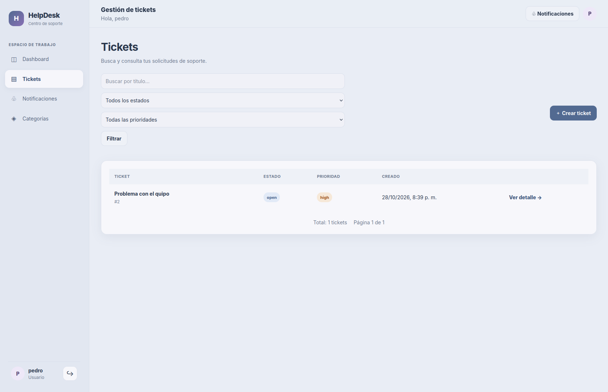

Consulta de las solicitudes y utilización de los filtros de búsqueda.

</td>
</tr>
</table>

### 🔔 3.3. Notificaciones y categorías

<table>
<tr>
<td width="50%" valign="top">

**Notificaciones sin pendientes**

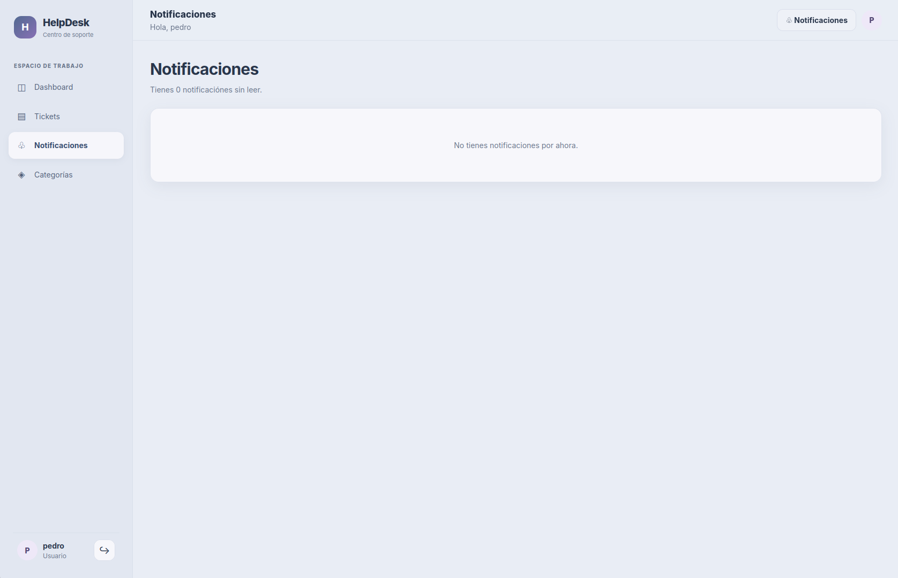

Vista del panel de notificaciones cuando no hay avisos pendientes.

</td>
<td width="50%" valign="top">

**Categorías disponibles**

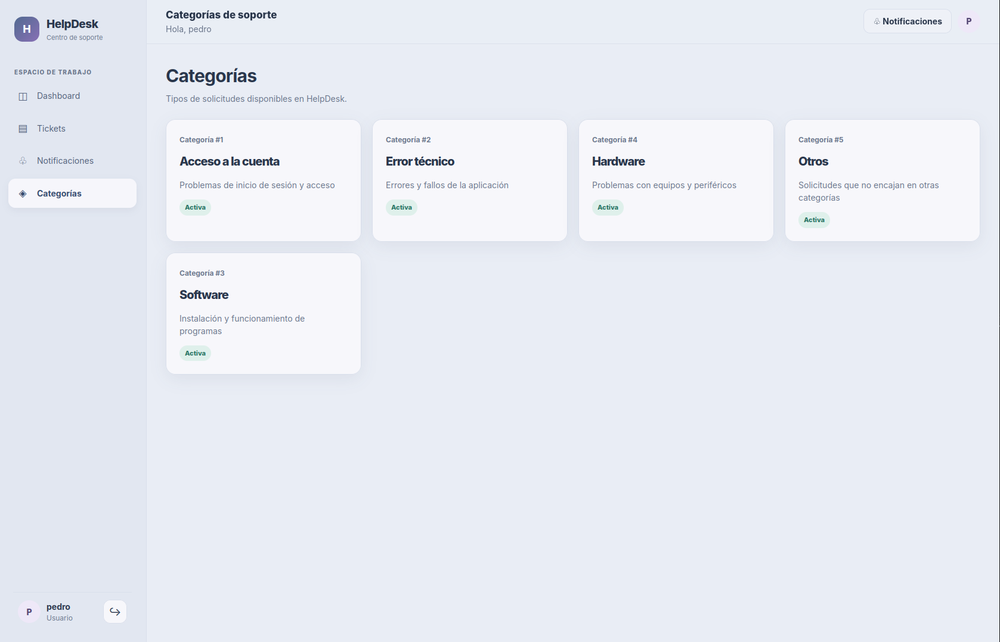

Categorías activas que pueden utilizarse al registrar un ticket.

</td>
</tr>
</table>

### 🛡️ 3.4. Administración

<table>
<tr>
<td width="50%" valign="top">

**Dashboard administrativo**

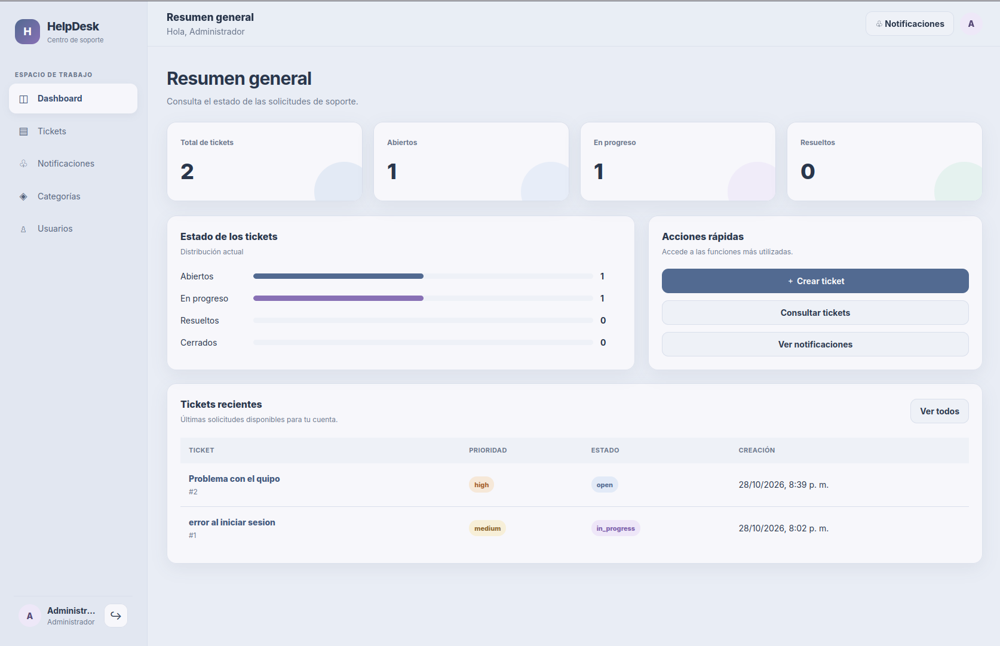

Panel de control para consultar la actividad de soporte.

</td>
<td width="50%" valign="top">

**Administración de categorías**

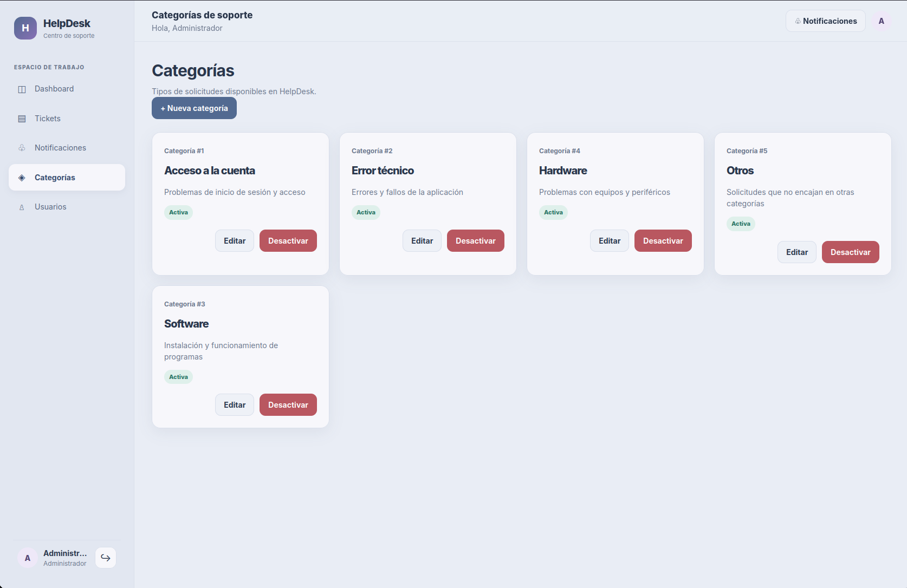

Creación, edición, activación y desactivación de categorías.

</td>
</tr>
<tr>
<td width="50%" valign="top">

**Usuarios registrados**

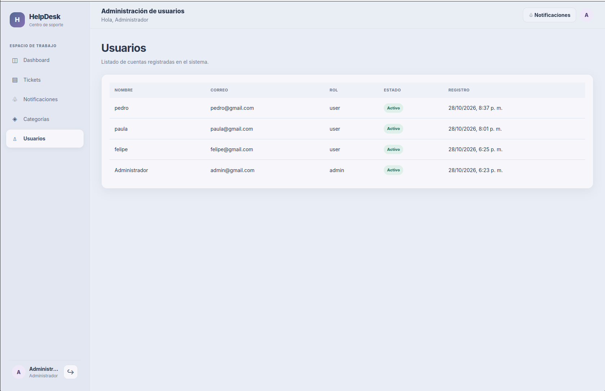

Consulta de las cuentas registradas en el sistema.

</td>
<td width="50%" valign="top">

**Gestión de tickets**

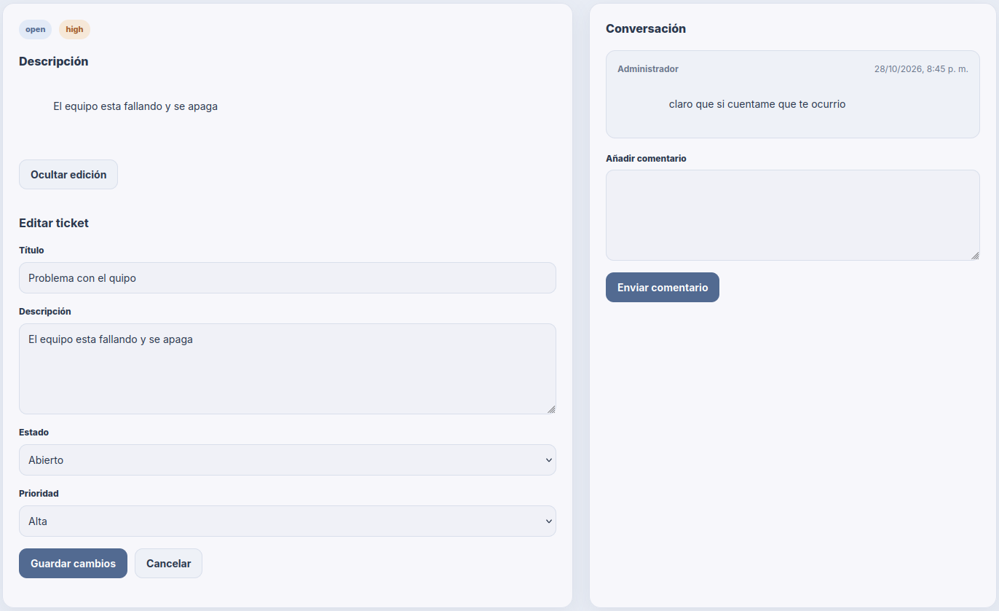

El administrador puede conversar con los usuarios, editar los datos de las solicitudes y gestionar su estado y prioridad.

</td>
</tr>
</table>

### 📬 3.5. Notificación después de una actualización

<div align="center">
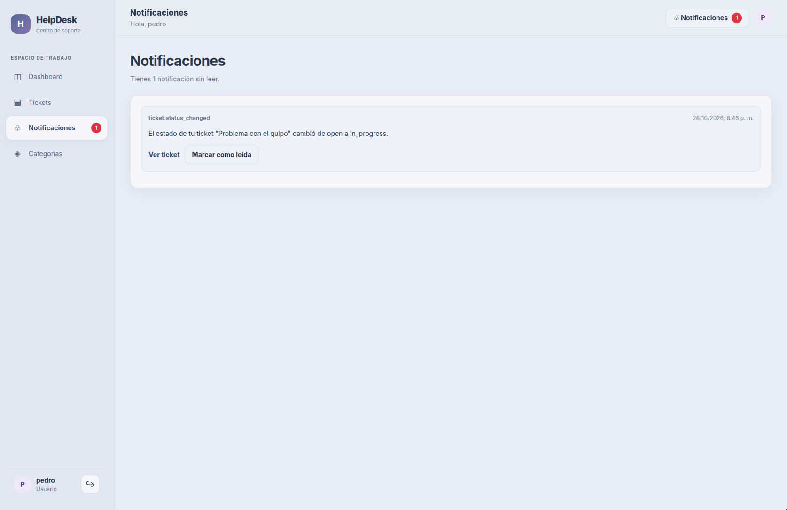
</div>

Esta vista muestra una notificación generada después de una acción administrativa. El usuario puede consultar el aviso y marcarlo como leído para actualizar el indicador de notificaciones pendientes.

---

## 🧰 4. Tecnologías utilizadas

### Backend y API REST

| Tecnología | Función |
|---|---|
| **Node.js** | Entorno de ejecución del servidor. |
| **Express.js** | Servidor HTTP, rutas y middleware. |
| **JavaScript** | Implementación de controladores, servicios y lógica de negocio. |
| **JSON Web Token (JWT)** | Autenticación mediante tokens. |
| **bcrypt** | Protección de contraseñas mediante hash. |
| **SQL** | Consultas y operaciones sobre la base de datos. |
| **OpenAPI** | Descripción de la API en `backend/docs/openapi.yaml`. |

### Base de datos

| Tecnología | Función |
|---|---|
| **PostgreSQL** | Almacenamiento persistente de usuarios, tickets, comentarios y notificaciones. |
| **SQL** | Definición de tablas, restricciones y operaciones de datos. |
| **Migraciones SQL** | Creación progresiva de la estructura de la base de datos. |

### Frontend

| Tecnología | Función |
|---|---|
| **HTML5** | Estructura de la aplicación web. |
| **CSS3** | Estilos, componentes y diseño adaptable. |
| **JavaScript** | Navegación, eventos e integración con la API. |
| **Vite** | Servidor de desarrollo y herramientas de construcción del frontend. |
| **SVG** | Iconos e imágenes vectoriales de la interfaz. |

### Contenedores y desarrollo

| Tecnología | Función |
|---|---|
| **Docker** | Empaquetado de servicios en contenedores. |
| **Docker Compose** | Orquestación local del frontend, backend y base de datos. |
| **Dockerfile** | Instrucciones de construcción para cada servicio. |
| **Git** | Control de versiones. |
| **GitHub** | Alojamiento del código fuente. |
| **Linux / WSL** | Entorno de desarrollo y ejecución de comandos. |
| **npm** | Gestión de paquetes y dependencias de Node.js. |

### Seguridad y calidad del código

- Autenticación mediante JWT.
- Hash de contraseñas con bcrypt.
- Middleware para autenticar y autorizar solicitudes.
- Validaciones de entrada.
- Manejo centralizado de errores.
- Pruebas automatizadas con archivos de prueba para distintos módulos del backend.

---

## 🏗️ 5. Arquitectura del proyecto

La aplicación está organizada en tres servicios principales:

<table>
<tr>
<td align="center" width="33%" valign="top">

### 🌐 Frontend

**Vite + JavaScript**

Interfaz, navegación, formularios, vistas y consumo de la API.

</td>
<td align="center" width="33%" valign="top">

### ⚙️ Backend

**Node.js + Express**

Autenticación, permisos, validaciones, lógica de negocio y endpoints REST.

</td>
<td align="center" width="33%" valign="top">

### 🗄️ Base de datos

**PostgreSQL**

Persistencia de usuarios, categorías, tickets, comentarios, historial y notificaciones.

</td>
</tr>
</table>

El flujo general es:

```text
Usuario
   │
   ▼
Frontend web
   │
   │ Solicitudes HTTP / API REST
   ▼
Backend Node.js + Express
   │
   ├── Autenticación y autorización
   ├── Validación de solicitudes
   ├── Controladores y servicios
   ├── Repositorios
   └── Manejo de errores
   │
   ▼
PostgreSQL
   │
   └── Datos persistentes
```

### 📂 Estructura del repositorio

La siguiente estructura corresponde a los archivos compartidos del proyecto. Se excluyen `node_modules` y archivos locales como `.env`.

```text
ProyectoGestorDeTickets/
├── LICENSE
├── README.md
├── .env.example
├── .gitignore
├── compose.yaml
│
├── assets/
│   ├── imagen_01.png
│   ├── imagen_02.png
│   ├── imagen_03.png
│   ├── imagen_04.png
│   ├── imagen_05.png
│   ├── imagen_06.png
│   ├── imagen_07.png
│   ├── imagen_08.png
│   ├── imagen_09.png
│   ├── imagen_10.png
│   ├── imagen_11.png
│   ├── imagen_12.png
│   ├── imagen_13.png
│   ├── imagen_14.png
│   └── imagen_15.png
│
├── backend/
│   ├── Dockerfile
│   ├── package.json
│   ├── package-lock.json
│   ├── docs/
│   │   └── openapi.yaml
│   ├── src/
│   │   ├── app.js
│   │   ├── server.js
│   │   ├── config/
│   │   │   ├── database.js
│   │   │   └── env.js
│   │   ├── middlewares/
│   │   │   ├── authenticate.js
│   │   │   ├── authorize.js
│   │   │   ├── errorHandler.js
│   │   │   ├── notFound.js
│   │   │   └── validateRequest.js
│   │   ├── modules/
│   │   │   ├── audit/
│   │   │   ├── auth/
│   │   │   ├── categories/
│   │   │   ├── comments/
│   │   │   ├── dashboard/
│   │   │   ├── notifications/
│   │   │   ├── tickets/
│   │   │   └── users/
│   │   └── utils/
│   │       ├── AppError.js
│   │       ├── asyncHandler.js
│   │       └── pagination.js
│   └── tests/
│       ├── auth.test.js
│       ├── comments.test.js
│       ├── tickets.test.js
│       └── users.test.js
│
├── db/
│   ├── Dockerfile
│   ├── migrations/
│   │   ├── 001_create_users.sql
│   │   ├── 002_create_categories.sql
│   │   ├── 003_create_tickets.sql
│   │   ├── 004_create_comments.sql
│   │   ├── 005_create_ticket_history.sql
│   │   └── 006_create_notifications.sql
│   └── seeds/
│       └── development.sql
│
└── frontend/
    ├── Dockerfile
    ├── index.html
    ├── package.json
    ├── package-lock.json
    ├── vite.config.js
    ├── public/
    │   ├── favicon.svg
    │   └── images/
    │       └── logo.svg
    └── src/
        ├── assets/
        │   └── icons/
        ├── css/
        │   ├── components.css
        │   ├── dashboard.css
        │   ├── forms.css
        │   ├── layout.css
        │   ├── main.css
        │   ├── responsive.css
        │   ├── tickets.css
        │   └── variables.css
        └── js/
            ├── app.js
            ├── router.js
            ├── components/
            ├── config/
            ├── pages/
            ├── services/
            └── utils/
```

> **Nota:** la estructura anterior resume algunos subdirectorios para facilitar la lectura. Los archivos y subdirectorios completos del backend y frontend aparecen en sus carpetas correspondientes.

### ¿Qué responsabilidad tiene cada carpeta?

| Ruta | Responsabilidad |
|---|---|
| `backend/src/config/` | Configuración de conexión a la base de datos y variables de entorno. |
| `backend/src/middlewares/` | Autenticación, autorización, validación y gestión de errores. |
| `backend/src/modules/` | Funcionalidades de negocio separadas por módulos. |
| `backend/src/utils/` | Funciones auxiliares reutilizables. |
| `backend/tests/` | Pruebas automatizadas del backend. |
| `backend/docs/` | Documentación de la API. |
| `db/migrations/` | Definición progresiva del esquema SQL. |
| `db/seeds/` | Datos de inicialización para desarrollo. |
| `frontend/src/css/` | Estilos visuales de la interfaz. |
| `frontend/src/js/components/` | Componentes compartidos de la interfaz. |
| `frontend/src/js/pages/` | Vistas de cada sección de la aplicación. |
| `frontend/src/js/services/` | Comunicación del frontend con los endpoints del backend. |
| `frontend/src/js/config/` | Configuración de acceso a la API. |
| `frontend/src/js/utils/` | Validadores, formato de fechas, permisos y almacenamiento. |
| `assets/` | Capturas utilizadas en este README. |

### Organización modular del backend

Cada módulo separa sus responsabilidades para facilitar el mantenimiento.

| Archivo | Responsabilidad habitual |
|---|---|
| `*.routes.js` | Define los endpoints y los middleware aplicables. |
| `*.controller.js` | Recibe las solicitudes HTTP y coordina las respuestas. |
| `*.service.js` | Contiene la lógica de negocio. |
| `*.repository.js` | Encapsula operaciones de acceso a los datos. |
| `*.validation.js` | Define las validaciones de entrada cuando el módulo las necesita. |

No todos los módulos requieren los mismos archivos. Por ejemplo, `audit` cuenta con un repositorio y un servicio, mientras que `dashboard` se centra en su controlador, rutas y servicio.

---

## 💻 6. Requisitos previos

Para descargar y ejecutar el proyecto se necesita:

- [Git](https://git-scm.com/)
- [Docker Desktop](https://www.docker.com/products/docker-desktop/) con Docker Compose, o Docker Engine con el complemento Compose.
- Una terminal compatible con los comandos indicados.
- Conexión a Internet para descargar el repositorio y las imágenes necesarias durante la primera ejecución.

No es necesario instalar Node.js ni PostgreSQL directamente en el sistema para ejecutar los tres servicios mediante Docker Compose.

---

## 🚀 7. Instalación y ejecución con Docker Compose

### Paso 1. Clonar el repositorio

Reemplaza la URL de ejemplo por la URL real del repositorio cuando lo publiques en GitHub.

```bash
git clone https://github.com/overrun1026/ProyectoGestorDeTickets.git
cd ProyectoGestorDeTickets
```

### Paso 2. Crear el archivo `.env`

Desde la raíz del proyecto, genera claves aleatorias para PostgreSQL y JWT:

```bash
printf "POSTGRES_PASSWORD=" > .env
openssl rand -hex 32 >> .env

printf "JWT_SECRET=" >> .env
openssl rand -hex 32 >> .env
```

El comando crea el archivo `.env` con dos variables y valores aleatorios. No compartas su contenido.

Si tu terminal no tiene `openssl`, puedes crear valores aleatorios seguros con una herramienta equivalente y pegarlos manualmente en el archivo.

### Paso 3. Revisar la configuración

Comprueba que el archivo `.env` existe:

```bash
cat .env
```

Hazlo únicamente en tu equipo privado; no pegues la salida en publicaciones, incidencias públicas ni repositorios.

El archivo debe contener dos variables:

```dotenv
POSTGRES_PASSWORD=TU_CLAVE_ALEATORIA_DE_POSTGRES
JWT_SECRET=TU_SECRETO_ALEATORIO_DE_JWT
```

Sustituye los valores de ejemplo por las claves generadas. No uses literalmente esos textos.

### Paso 4. Construir e iniciar los servicios

Desde la raíz del repositorio:

```bash
docker compose up -d --build
```

Docker Compose construirá las imágenes y pondrá en marcha los servicios definidos en `compose.yaml`:

- **db:** base de datos PostgreSQL.
- **backend:** API REST de Node.js y Express.
- **frontend:** interfaz web servida mediante Vite.

### Paso 5. Comprobar el estado

```bash
docker compose ps
```

Para consultar los registros de los servicios:

```bash
docker compose logs -f
```

Para salir de los registros sin detener los contenedores, utiliza `Ctrl + C`.

### Paso 6. Abrir la aplicación

Cuando los servicios estén listos, abre la interfaz en el navegador:

**[http://localhost:8080](http://localhost:8080)**

El backend está publicado en el puerto `3000`:

**[http://localhost:3000](http://localhost:3000)**

La ruta exacta de comprobación de salud depende de los endpoints que exponga la aplicación; el puerto abierto por sí solo no garantiza que una ruta específica exista.

---

## 🔑 8. Variables de entorno y claves

La configuración de Docker Compose utiliza las variables definidas en el `.env` de la raíz del proyecto.

| Variable | Propósito |
|---|---|
| `POSTGRES_PASSWORD` | Contraseña del usuario de PostgreSQL utilizado por la aplicación. |
| `JWT_SECRET` | Secreto utilizado para firmar y verificar los tokens JWT. |

El archivo `.env` es privado y no debe subirse a GitHub.

### Archivo `.env.example`

Para que otras personas puedan conocer la configuración necesaria sin recibir tus secretos, puedes incluir un archivo `.env.example` en la raíz:

```dotenv
POSTGRES_PASSWORD=
JWT_SECRET=
```

Este archivo es una plantilla. Quien clone el proyecto deberá generar sus propias claves y crear su archivo `.env`.

### Configuración del backend

El servicio backend recibe su configuración desde `compose.yaml`. Entre las variables configuradas se encuentran:

| Variable | Propósito |
|---|---|
| `NODE_ENV` | Entorno de ejecución. |
| `PORT` | Puerto interno del backend. |
| `DATABASE_URL` | Cadena de conexión a PostgreSQL. |
| `JWT_SECRET` | Secreto de firma de los tokens. |
| `JWT_EXPIRES_IN` | Tiempo de validez del token. |
| `FRONTEND_URL` | Origen permitido para el frontend. |
| `DB_SSL` | Configuración SSL de la conexión a la base de datos. |

En Docker, la base de datos se alcanza mediante el nombre del servicio `db`, no mediante `localhost`. La cadena de conexión se construye usando la contraseña definida en el entorno.

### Importante sobre PostgreSQL

Cambiar `POSTGRES_PASSWORD` en `.env` no cambia automáticamente la contraseña de una base de datos que ya fue inicializada dentro de un volumen existente. La contraseña almacenada y la configuración del contenedor deben coincidir.

**No uses `docker compose down -v` para solucionar problemas de conexión sin comprender las consecuencias:** elimina los volúmenes administrados por Compose y puede borrar permanentemente los datos de la base de datos.

---

## 🛡️ 9. Crear la cuenta de administrador

La aplicación diferencia entre cuentas normales y cuentas administrativas. No se debe asumir que existe una contraseña de administrador predeterminada.

### Paso 1. Registrar una cuenta

1. Inicia la aplicación en `http://localhost:8080`.
2. Accede a la pantalla de registro.
3. Crea una cuenta con un correo al que tengas acceso.
4. Inicia sesión para verificar que el registro funciona.

Una cuenta creada desde el formulario público recibe el rol normal definido por el sistema.

### Paso 2. Asignar el rol de administrador

Para una instalación local nueva, puedes promover tu propia cuenta mediante PostgreSQL.

Abre una terminal en la raíz del proyecto y ejecuta:

```bash
docker compose exec db psql -U helpdesk -d helpdesk
```

Dentro de `psql`, ejecuta la siguiente consulta, sustituyendo el correo por el de la cuenta que registraste:

```sql
UPDATE users
SET role = 'admin'
WHERE email = 'tu-correo@ejemplo.com';
```

Comprueba el resultado:

```sql
SELECT id, name, email, role, is_active
FROM users
WHERE email = 'tu-correo@ejemplo.com';
```

Si el correo coincide con una cuenta existente, su rol debe aparecer como `admin`.

Sal de PostgreSQL:

```sql
\q
```

Cierra la sesión de la aplicación e inicia sesión nuevamente para obtener un token JWT con el rol actualizado.

> **Seguridad:** realiza este procedimiento solo en una instalación que administres. No promociones cuentas de terceros ni expongas credenciales o tokens. En un despliegue de producción, es preferible implementar un proceso de inicialización administrativa controlado y documentado.

---

## 🔄 10. Cómo funciona la aplicación

### Flujo de un usuario

1. **Registro e inicio de sesión.** El usuario crea una cuenta y se autentica.
2. **Acceso al dashboard.** Consulta el resumen de su actividad y las solicitudes disponibles.
3. **Creación del ticket.** Introduce un título, una descripción, una prioridad y una categoría.
4. **Consulta y seguimiento.** Accede al listado, utiliza los filtros y revisa el detalle de la incidencia.
5. **Comunicación.** Añade comentarios para facilitar el diagnóstico y la resolución.
6. **Notificaciones.** Consulta los avisos generados por acciones relevantes.
7. **Lectura de avisos.** Marca las notificaciones como leídas para actualizar el indicador de pendientes.

### Flujo del administrador

1. Inicia sesión con una cuenta que tenga el rol `admin`.
2. Accede al panel administrativo.
3. Consulta los tickets y los usuarios registrados.
4. Administra las categorías disponibles.
5. Revisa los comentarios y conversa con los usuarios.
6. Modifica el estado y la prioridad de los tickets.
7. Genera cambios que pueden producir notificaciones para el usuario.

### Ciclo de vida de un ticket

```text
┌─────────────────────┐
│ Usuario crea ticket │
└──────────┬──────────┘
           ▼
┌─────────────────────┐
│ Ticket registrado   │
└──────────┬──────────┘
           ▼
┌─────────────────────┐
│ Revisión y diálogo  │
└──────────┬──────────┘
           ▼
┌─────────────────────┐
│ Atención del caso   │
└──────────┬──────────┘
           ▼
┌─────────────────────┐
│ Actualización estado│
└──────────┬──────────┘
           ▼
┌─────────────────────┐
│ Usuario recibe aviso│
└─────────────────────┘
```

Este diagrama representa el flujo general de trabajo; los cambios concretos de estado dependen de las reglas de negocio implementadas en el backend.

### ¿Cómo se comunica el frontend con el backend?

El frontend utiliza módulos de servicio para realizar solicitudes HTTP a la API REST. El backend recibe cada petición, aplica los middleware correspondientes, ejecuta la lógica de negocio y accede a PostgreSQL cuando es necesario.

Por ejemplo, una solicitud para consultar tickets sigue este flujo:

1. El usuario abre el listado de tickets.
2. El frontend llama al servicio correspondiente.
3. La API valida la autenticación y los permisos.
4. El backend consulta los datos.
5. La API devuelve la respuesta HTTP.
6. El frontend actualiza la interfaz con los resultados.

La separación de responsabilidades facilita mantener el código y ampliar las funcionalidades sin concentrar toda la lógica en un único archivo.

---

## 📡 11. API y documentación

La documentación de la API está ubicada en:

```text
backend/docs/openapi.yaml
```

Este archivo contiene la especificación OpenAPI del proyecto. Puede utilizarse como base para consultar y mantener documentados los endpoints.

Los módulos principales del backend son:

| Módulo | Responsabilidad |
|---|---|
| `auth` | Registro, inicio de sesión y autenticación. |
| `users` | Gestión y consulta de usuarios. |
| `tickets` | Creación, consulta y actualización de tickets. |
| `categories` | Gestión de categorías. |
| `comments` | Comentarios asociados a tickets. |
| `notifications` | Consulta y actualización de notificaciones. |
| `dashboard` | Datos agregados para los paneles de control. |
| `audit` | Operaciones de auditoría. |

Las rutas específicas, los métodos HTTP y los formatos de las respuestas deben consultarse en la documentación OpenAPI y en los archivos `*.routes.js` de cada módulo.

---

## 🧪 12. Comandos útiles

Ejecuta estos comandos desde la raíz del repositorio.

### Gestión de servicios

```bash
# Construir e iniciar todos los servicios
docker compose up -d --build

# Ver los servicios activos
docker compose ps

# Consultar los registros
docker compose logs -f

# Consultar los registros del backend
docker compose logs -f backend

# Consultar los registros de PostgreSQL
docker compose logs -f db

# Detener los servicios sin eliminar los volúmenes
docker compose down

# Reconstruir e iniciar los servicios
docker compose up -d --build
```

### Acceso a PostgreSQL

```bash
docker compose exec db psql -U helpdesk -d helpdesk
```

Dentro de PostgreSQL:

```sql
-- Mostrar tablas
\dt

-- Describir la tabla de usuarios
\d users

-- Salir
\q
```

### Ejecutar pruebas del backend

Los archivos de pruebas están en `backend/tests/`. Si el entorno y las dependencias del backend están preparados para ejecutar las pruebas, puedes utilizar:

```bash
docker compose exec backend npm test
```

Este comando requiere que el contenedor backend incluya las dependencias necesarias y que `backend/package.json` defina el script `test`. Si no se cumple alguna de estas condiciones, revisa el `package.json` y el entorno de pruebas antes de ejecutarlo.

---

## 🔒 13. Seguridad y buenas prácticas

- No subas archivos `.env` a GitHub.
- No compartas secretos JWT ni contraseñas de bases de datos.
- Genera claves distintas para cada entorno.
- Utiliza contraseñas robustas y únicas.
- Protege las rutas administrativas con autorización basada en roles.
- Valida los datos que recibe el backend.
- Evita exponer puertos y servicios internos innecesariamente en producción.
- Configura HTTPS y una política CORS adecuada al desplegar públicamente.
- Mantén actualizadas las dependencias y revisa los registros de seguridad.
- Realiza copias de seguridad de PostgreSQL antes de efectuar cambios destructivos.
- No publiques datos personales, contraseñas ni tokens en capturas de pantalla.

La configuración incluida en este repositorio está orientada a ejecutar el proyecto localmente. Antes de desplegarlo en producción, revisa la configuración de seguridad, los permisos, los secretos y las políticas de acceso.

---

## 👨‍💻 14. Autor

<div align="center">

### Leonardo Gracia

Ingeniero Electrónico · Desarrollador de software

Interesado en el desarrollo backend, las API REST, las bases de datos y la automatización de entornos mediante contenedores.

<br>

<a href="https://github.com/overrun1026">
  
</a>
<a href="https://www.linkedin.com/in/leonardo-gracia-71222124b/">
  
</a>
<a href="https://www.leonardogracia.com">
  
</a>

</div>

---

## ⚖️ 15. Licencia

Este proyecto se distribuye bajo la **Licencia MIT**. Consulta el archivo [`LICENSE`](LICENSE) incluido en la raíz del repositorio para ver el texto completo de la licencia.

La licencia permite utilizar, copiar, modificar, fusionar, publicar, distribuir, sublicenciar y vender copias del software, siempre que se conserven el aviso de copyright y el aviso de permiso correspondientes.

La distribución se realiza **sin garantía**, de acuerdo con los términos de la licencia.

<details>
<summary><strong>Texto completo de la licencia MIT</strong></summary>

```text
MIT License

Copyright (c) 2026 Leonardo Gracia

Permission is hereby granted, free of charge, to any person obtaining a copy
of this software and associated documentation files (the "Software"), to deal
in the Software without restriction, including without limitation the rights
to use, copy, modify, merge, publish, distribute, sublicense, and/or sell
copies of the Software, and to permit persons to whom the Software is
furnished to do so, subject to the following conditions:

The above copyright notice and this permission notice shall be included in all
copies or substantial portions of the Software.

THE SOFTWARE IS PROVIDED "AS IS", WITHOUT WARRANTY OF ANY KIND, EXPRESS OR
IMPLIED, INCLUDING BUT NOT LIMITED TO THE WARRANTIES OF MERCHANTABILITY,
FITNESS FOR A PARTICULAR PURPOSE AND NONINFRINGEMENT. IN NO EVENT SHALL THE
AUTHORS OR COPYRIGHT HOLDERS BE LIABLE FOR ANY CLAIM, DAMAGES OR OTHER
LIABILITY, WHETHER IN AN ACTION OF CONTRACT, TORT OR OTHERWISE, ARISING FROM,
OUT OF OR IN CONNECTION WITH THE SOFTWARE OR THE USE OR OTHER DEALINGS IN THE
SOFTWARE.
```

</details>

<div align="center">

**HelpDesk · Sistema de gestión de tickets y soporte técnico**

Desarrollado por Leonardo Gracia.

</div>
